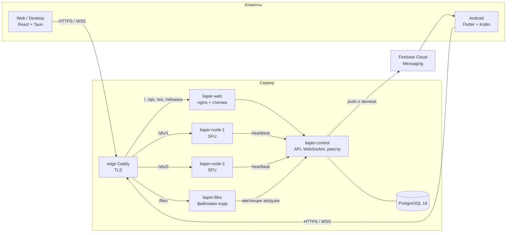

# Архитектура Liaper

Liaper — сервис уроков для репетиторов и учеников: звонки (один на один и групповые), чаты с шифрованием на устройстве, вложения, голосовые и видеокружки, архив переписки уроков, автообновление клиентов. Документ описывает, из чего состоит система, как части связаны и где лежат данные. Состояние на версию **0.2.1** (22 октября 2026).

Соседние документы: развёртывание и безопасность — [PRODUCTION.md](PRODUCTION.md), протокол вложений — [FILE_STORAGE.md](FILE_STORAGE.md), развёртывание на liaper.ru — [deploy/edge/README.md](../deploy/edge/README.md).

## Компоненты

| Компонент | Где | Что делает |
| --- | --- | --- |
| `liaper-control` | `crates/control-server` | Регистрация и вход, контакты, комнаты и звонки, чаты (хранит только шифротекст), конверты ключей, архивы уроков, учёт вложений, выдача допусков в SFU, push через FCM, реестр релизов, админка и антифрод. HTTP API + WebSocket `/ws` |
| `liaper-node` (×2) | `crates/media-node` | SFU: пересылает звук и видео между участниками комнаты. Пускает только по подписанному допуску, раз в 2 с шлёт нагрузку на control |
| `liaper-files` | `crates/file-node` | Хранит зашифрованные блобы вложений, проверяет размер и SHA-256, удаляет просроченное |
| `liaper-common` | `crates/common` | Общие типы протокола (`ClientToControlMsg`, `ControlToClientMsg`, `ClientToNodeMsg`…), подпись допусков SFU, хранение файлов, реестр релизов |
| `liaper-web` | `clients/web-desktop` + `nginx.conf` | Сайт, лендинг и web-клиент; nginx проксирует `/api`, `/ws`, `/releases` на control и ставит CSP |
| Desktop | `clients/web-desktop/src-tauri` | Тот же web-клиент в Tauri v2 (Windows, Linux) + плагины updater, notification, opener |
| Android | `clients/android` | Flutter-интерфейс; звук, запись, плеер, уведомления о звонках и FCM — нативно в Kotlin через канал `com.liaper.audio` |
| PostgreSQL | `docker/init.sql` | Источник истины для пользователей, контактов, сообщений, ключей, сессий, вложений, архивов, push-токенов |

Без `DATABASE_URL` control работает на JSON-файлах в `data/` (режим разработки). При первом подключении к PostgreSQL эти файлы один раз импортируются.

## Сеть и развёртывание

На liaper.ru все сервисы — контейнеры `docker-compose.yml` на одном VPS. Порты наружу не открыты (`deploy/edge/compose.override.yaml`). HTTPS и маршрутизацию по путям держит общий edge-Caddy (`deploy/edge/liaper.ru.caddy`), который обслуживает и другие проекты на этом сервере.

- Контейнеры работают от пользователя `10001` с read-only файловой системой.
- Секреты лежат в `.env` (не в Git). Ключ Firebase — в `secrets/fcm-service-account.json`, примонтирован только для чтения.
- Обновление сервера: `git archive HEAD` → `/opt/liaper` → `docker compose up -d --build` (команды — в `deploy/edge/README.md`).
- Схема БД применяется при каждом старте control (`init.sql` состоит из `CREATE … IF NOT EXISTS`), миграций отдельным шагом нет.

## Пользователи, сессии, контакты

- **Аккаунт:** `@ник`, отображаемое имя, роль `tutor` или `student`. Пароли хешируются Argon2id. Регистрацию защищает proof-of-work (`GET /api/auth/challenge`), сложность растёт при наплыве.
- **Сессия:** случайный токен (`user_sessions`), живёт до 30 дней. Передаётся заголовком `Authorization: Bearer`, а в WebSocket — параметром `?token=`. nginx не пишет `/ws` в журнал, чтобы токен не попал в логи.
- **Контакты:** взаимные, через заявку и подтверждение. Звонить и писать можно только подтверждённому контакту. У репетитора не больше 10 учеников, групповой урок создаёт только репетитор (проверяется на сервере).
- **Несколько устройств:** один аккаунт может держать до 6 WebSocket одновременно, событие приходит на все устройства. Звонок привязан к одному устройству (`call_devices`), на остальных видна плашка «урок идёт на другом устройстве» с кнопкой переноса.

## Звонки

### Сигналинг (control, WebSocket `/ws`)

1. Звонящий отправляет `call_by_nick`, а для группового урока — `create_room` с приглашёнными. Control создаёт комнату (`RoomInfo`, только в памяти) и выбирает наименее загруженную медиа-ноду.
2. Адресат получает `incoming_call` по WebSocket на все живые устройства и push через FCM на Android-устройства. Неотвеченный звонок control помнит 45 с (`pending_calls`) и повторяет при переподключении. Так приложение, разбуженное push, тоже узнаёт о звонке.
3. `join_room` принимает звонок, `decline_call` отклоняет. Если звонящий сбросил, адресату приходит `call_on_other_device { room: None }` и push «отбой».
4. Клиент берёт подписанный допуск `POST /api/rooms/:id/sfu-ticket` (действует 2 минуты, привязан к комнате, пользователю и ноде) и подключается к ноде.

### Медиа (SFU, WebSocket `/sfu/N/ws/sfu`)

Медиа идёт не через WebRTC-транспорт, а JSON-сообщениями `encrypted_media_frame` по WebSocket ноды. Каждый кадр зашифрован на устройстве (см. ниже), нода пересылает непрозрачные данные:

| Поток | Формат | Темп |
| --- | --- | --- |
| Звук | PCM 16 бит, 16 кГц, моно, base64 | порции по 32 мс |
| Видео | JPEG, base64: камера до 640 px, демонстрация экрана до 1280 px | 12 к/с web, 10 к/с Android |

Задержку ограничивают в трёх местах:
- **Отправитель.** Web пропускает кадр, если в сокете больше 32 КБ (видео) или 64 КБ (звук).
- **Нода.** Для каждого получателя держит не больше 2 видеокадров в очереди, лишние выбрасывает. Звук не выбрасывается.
- **Получатель.** Очередь воспроизведения не длиннее 200 мс, опоздавший звук выбрасывается.

**Сквозное шифрование медиа (с 0.2.2).**
- Каждая порция звука и каждый видеокадр шифруются ключом комнаты, тем же AES-256-GCM, что у чата (раздел ниже). На каждый кадр берётся свой случайный IV 12 байт.
- В `iv_b64` лежит IV, в `ciphertext_b64` — шифротекст с тегом, в `room_key_id` — id ключа.
- К шифротексту привязаны комната, отправитель и тип потока: `AAD = "liaper-media-v1|<room_id>|<sender_id>|<kind>"`. Кадр нельзя переложить в другую комнату или выдать за другого участника.
- Отправитель без ключа комнаты кадр не шлёт. Получатель отбрасывает кадр с неизвестным ключом, подделанный или незашифрованный, поэтому клиенты 0.2.1 и новые звонить друг другу не могут.
- Реализация: web — `src/crypto/mediaFrames.ts` (WebCrypto, порядок кадров держат цепочки промисов); Android — `MediaFrameCipher.kt` (`javax.crypto`, аппаратный AES). Ключи туда передаёт Dart методом `setMediaKeys` при каждом изменении связки ключей.
- Общий тестовый вектор: `tests/fixtures/media-frame-v1.json`.
- Цена: около 0,1 мс на порцию звука и 0,5 мс на видеокадр. К каждому кадру добавляется 28 байт.
- Серверу по-прежнему видны метаданные: кто с кем говорит, когда и какого размера кадры.

При входе в комнату нода выдаёт клиентам STUN-серверы Google и необязательный TURN (`LIAPER_TURN_*`), а также пересылает сигналы WebRTC (`signal_sdp_offer` и др.). Сейчас клиенты WebRTC-соединений не создают, поэтому эта часть не используется.

## Чаты и сквозное шифрование

- У каждого устройства своя пара ключей **X25519**. Публичные ключи хранятся в профиле, у аккаунта до 8 ключей.
- У комнаты или личного диалога свой случайный ключ **AES-256-GCM**. Клиент упаковывает его для каждого X25519-ключа каждого участника. Ключ обёртки — SHA-256 от общего секрета и метки `liaper-x25519-wrap-v1`. Готовые конверты передаются через `send_key_envelope` и хранятся в `e2ee_key_envelopes`.
- Когда участник уходит из комнаты, ключ ротируется.
- Сообщение шифруется ключом комнаты на устройстве. Сервер хранит в `chat_messages` только шифротекст, IV и id ключа. Внутри шифротекста — текст, данные пересылки и описание вложения с ключом файла.
- Ссылки в сообщениях кликабельны (`http`, `https`, `www.`) и открываются во внешнем браузере. Превью не загружаются, чтобы сайт не узнал о прочтении.

## Вложения, голосовые, видеокружки

Подробно описаны в [FILE_STORAGE.md](FILE_STORAGE.md).
- Клиент шифрует файл случайным ключом AES-256-GCM. Control резервирует место (квота 5 ГиБ на аккаунт, файл до 128 МиБ) и выдаёт токен загрузки на файловую ноду.
- Нода хранит непрозрачный блоб месяц и подтверждает загрузку подписанной квитанцией.
- Ключ файла передаётся только внутри зашифрованного сообщения.
- Голосовое сообщение — WAV. Видеокружок — свой формат LPVN: JPEG-кадры с метками времени плюс WAV.

## Архив уроков

- Пока идёт урок, клиент сохраняет переписку в локальный архив. Урок без сообщений не сохраняется.
- Архив синхронизируется между устройствами через `/api/lesson-archives`. На сервер уходит только зашифрованный блоб.
- Ключ архива выводится из пароля аккаунта: PBKDF2-SHA-256, 210 000 итераций, соль `liaper-archive-key-v1:<userId>`. Поэтому сервер не может прочитать архив, а после смены пароля архив нужно перешифровать.
- Конфликты решаются по ревизии со слиянием сообщений без дублей. Формат общий для web и Android (`tests/fixtures/lesson-archive-v1.json`).

## Уведомления о звонках

| Клиент | Приложение открыто | Свёрнуто или закрыто |
| --- | --- | --- |
| Web | рингтон по кругу, мигает заголовок вкладки | системное уведомление браузера, если вкладка жива |
| Desktop | рингтон, мигание на панели задач | системное уведомление Windows/Linux |
| Android | рингтон через громкость звонка, вибрация в такт, баннер | **FCM**: data-push будит приложение, системное уведомление звонит по кругу поверх экрана и блокировки, кнопки «Принять»/«Отклонить» |

- Рингтон: `clients/web-desktop/public/sounds/ringtone.wav` и `res/raw/ringtone.wav`.
- Push-токены хранятся в `push_tokens`. Токен переезжает к аккаунту, который вошёл на устройстве последним, и удаляется при выходе из аккаунта.
- Отправка идёт через FCM HTTP v1 (`crates/control-server/src/push.rs`), подпись OAuth — ключом сервисного аккаунта.
- В push уходит только имя звонящего, название урока и id комнаты.
- Без Google-сервисов на телефоне push не придёт: звонок будет только при открытом приложении.

## Обновления клиентов

Реестр — `data/releases.json` на сервере, публикация — `POST /api/releases/publish` с `LIAPER_ADMIN_SECRET`. Файлы лежат в `releases/` и раздаются по `/releases/…`.

- **Desktop:** Tauri updater, `GET /api/releases/tauri/:target/:arch/:current_version`. Сборки подписываются ключом Ed25519 (minisign), публичный ключ — в `tauri.conf.json`. Windows собирается локально (`npx tauri build`), Linux — в контейнере `deploy/linux-build/Dockerfile`.
- **Android:** `GET /api/releases/check?platform=android_arm64&version=…`, проверка SHA-256, установка поверх. Release-APK подписывается ключом из `android/key.properties`, адрес сервера задаётся при сборке: `--dart-define=LIAPER_SERVER_URL=https://liaper.ru`.
- Версия задаётся в нескольких местах, при выпуске надо поднять все:
  - `pubspec.yaml` и `kCurrentAppVersion` в `lib/main.dart` (Android);
  - `package.json`, `tauri.conf.json`, `src-tauri/Cargo.toml` и `APP_VERSION` в `App.tsx` (Desktop).

## Защита от злоупотреблений

`crates/control-server/src/antifraud.rs`:
- лимиты частоты: звонков не больше 6 в минуту, регистраций и входов — по IP за прокси (`LIAPER_TRUSTED_PROXY_HOPS`);
- потолки размеров сообщений и конвертов;
- не больше 6 WebSocket на аккаунт. Лимит в 3 активные комнаты на хоста (`MAX_ACTIVE_ROOMS_PER_HOST`) пока только показывается в админке и не проверяется;
- журнал инцидентов и карантин, которыми управляют из админки (`#admin`, мастер-пароль).

Жалобу на переписку отправляет участник диалога. К жалобе он сам прикладывает ключи комнаты, чтобы модератор мог прочитать снимок.

## Данные: где что хранится

| Данные | Где | В открытом виде на сервере |
| --- | --- | --- |
| Аккаунты, хеши паролей, публичные ключи | `users` | ник, имя, роль, публичные ключи |
| Звук и видео звонков | не хранятся, нода только пересылает | нет: зашифрованы ключом комнаты |
| Контакты и заявки | `contacts`, `contact_requests` | да |
| Сессии | `user_sessions` | токены (хеширование — задача P2) |
| Сообщения | `chat_messages` | только шифротекст и метаданные: кто, когда, где |
| Конверты ключей | `e2ee_key_envelopes` | только зашифрованные ключи |
| Вложения | `file_attachments`, `file_attachment_readers` + диск файловой ноды | размер, владелец, получатели, срок; содержимое зашифровано |
| Архивы уроков | `lesson_archives` | только зашифрованный блоб и ревизия |
| Push-токены | `push_tokens` | да |
| Комнаты, идущие звонки, неотвеченные вызовы | память control | — |
| Релизы | `data/releases.json`, `releases/` | да |

## Тесты

- `cargo test --workspace` — сервер и протокол: допуски SFU, Argon2id, роли, звонок на нескольких устройствах, неотвеченные звонки и push-токены, хранилище.
- `node --test clients/web-desktop/tests/*.test.mjs` — шифрование, вложения, архивы, пересылка, proof-of-work, разбор ссылок.
- `flutter test` в `clients/android` — архивы, ссылки, вёрстка на маленьких экранах.
- Проверка ключа FCM без реальной отправки: `FCM_SERVICE_ACCOUNT_FILE=… cargo test -p liaper-control-server fcm_credentials -- --ignored`.
