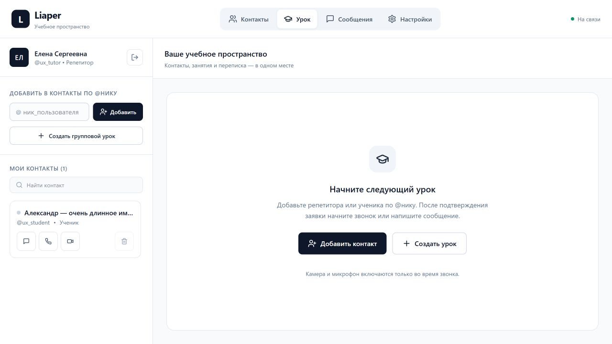

# Дополнение от 22 октября 2026

- Реальная локальная PostgreSQL подключена: профили, заявки, контакты и зашифрованные сообщения пишутся до подтверждения клиенту. JSON импортирован однократно; после перезапуска источником служит PostgreSQL.
- Архивы уроков синхронизируются между Android и Web/Windows в клиентски зашифрованных AES-256-GCM блобах. Ключ архива выводится из пароля через PBKDF2, владелец и ID урока привязаны AAD. После восстановления сессии архив требуется разблокировать паролем. Локальный кэш по-прежнему содержит открытый текст.
- Добавлена файловая нода, квота 5 ГиБ на отправителя, резервирование места, проверка SHA-256 шифротекста, подписанные допуски, хранение один календарный месяц и автоматическое удаление. Подробности и границы готовности клиентов: [FILE_STORAGE.md](FILE_STORAGE.md).
- В настройках Web/Windows и профиле Android показываются серверные объёмы. Приглашать в контакты может только преподаватель и только ученика; у преподавателя до 10 учеников. Проверка лимита выполняется также в PostgreSQL при принятии заявки.
- Закрыт вход в урок без приглашения и приглашение от постороннего. Welcome больше не раскрывает чужие активные комнаты.
- Android: своё видео перетаскивается с ограничением доступной области, сохраняет положение при повороте/переключении камеры; основные кнопки звонка не требуют горизонтальной прокрутки.
- Проверено: 10 Rust-тестов, включая настоящую отдельную PostgreSQL и конкуренцию за последнюю квоту/десятого ученика; 4 Node-теста архивов; 9 Flutter-тестов; сквозной тест двух серверов с клиентским шифрованием файла. Прошли Web, Windows debug и Android debug сборки. APK установлен обновлением с сохранением данных.
- В браузере отдельно проверены роли преподавателя/ученика и живой счётчик хранилища. Скриншот: [storage-settings.png](screenshots/storage-settings.png).

Ниже сохранён первоначальный аудит. Его строки про локальный архив, недолговечность чатов/PG и допуск в комнаты частично закрыты этим дополнением. P0 по старому обмену ключами чата, незашифрованным PCM/JPEG медиа и допуску на SFU остаются открытыми. Полный двусторонний звонок между физическими устройствами ещё не проверен.

---

# Liaper: UX/UI и технический аудит

Дата: 22 октября 2026. Проверены исходники Web/Desktop (React + Tauri), Android (Flutter), связанные сценарии API и медиа. Это инженерный аудит доступного проекта, без пользовательских интервью и полного тестирования безопасности.

## Что исправлено

| Область | Проблема | Изменение |
| --- | --- | --- |
| Web/Desktop | Три фиксированные колонки сжимали урок и выходили за границы небольших окон | До 900 px показывается одна область с нижней навигацией; 900–1439 px — контакты и выбранная область; от 1440 px — три панели |
| Навигация | В интерфейсе учеников показывались CPU, медиа-ноды и форма публикации релизов | Основные разделы: контакты, урок, сообщения, настройки; технические вкладки и публикация убраны |
| Начало работы | Пустой экран не предлагал понятного следующего действия | Кнопки добавления контакта и создания урока, тексты с учётом роли |
| Контакты | На Android четыре маленьких действия сжимали имя; удаление выполнялось сразу | Меню действий с подписями, подтверждение удаления на обеих платформах; различаются пустой список и пустой результат поиска |
| Соединение | Разрыв управляющего WebSocket был практически незаметен | Автоматические повторные подключения с ограничением частоты, видимый статус, повтор и повторный вход |
| Отправка | При отсутствии связи текст мог исчезнуть без отправки | Поле сохраняет черновик, отправка блокируется без связи; повторное нажатие во время шифрования блокируется |
| Чаты | Неактивный чат урока мог подставлять личный диалог и наоборот | Выбор комнаты строго соответствует режиму; в Web черновики разделены по диалогам |
| Сообщения | При ошибке расшифровки пользователю показывался Base64 | Понятный текст ошибки; в Web исправлен перенос длинных сообщений и добавлен индикатор непрочитанного |
| Android | Загрузка старой истории увеличивала счётчик непрочитанного | История отделена от новых событий; учитывается открытая переписка |
| Аккаунты | Локальный архив был общим для всех пользователей устройства | Новые архивы записываются по ID пользователя; состояние переписок очищается при выходе |
| Медиа | Выход из Web-аккаунта не останавливал устройства; показ экрана заменял микрофон | Треки останавливаются при выходе, микрофон сохраняется при показе экрана; обрабатывается штатная остановка показа браузером |
| Состояния камеры | При отказе в разрешении интерфейс мог показывать включённую камеру | Флаги отражают ошибку доступа; скрываются старые кадры выключенной камеры; Web позволяет повторно получить микрофон |
| Android UX | Переполнение регистрации и профиля на маленьком экране с большим шрифтом | Растягиваемый выбор роли, перенос заголовка версии, прокручиваемые элементы и доступные кнопки |
| Вход | Не было автозаполнения, показа пароля и понятной проверки полей | Добавлены подписи, автозаполнение, видимость пароля, локальная проверка Android и подсказка об адресе сервера |
| Доступность | Web-диалоги не удерживали фокус; состояние кнопок было только визуальным | Нативный dialog, Escape, возврат фокуса, видимый фокус клавиатуры, ARIA-подписи и состояния, reduced-motion |
| Desktop build | В README указаны отсутствующие npm-команды; Tauri не отделён от Rust workspace; нет обязательной иконки | Добавлены CLI, команды, lockfile, исключение из workspace, иконки из существующего монограмного знака; минимальное окно 640×480 |
| Web deployment | Встроенный адрес 127.0.0.1 ломал подключение с другого компьютера | Production Web использует свой origin, добавлен nginx proxy API/WS; отдельный адрес задаётся VITE_CONTROL_URL |
| Релизы | В клиенте и серверном fallback был общий известный admin-secret | Публикация убрана из клиента; без явно настроенного LIAPER_ADMIN_SECRET сервер отклоняет запросы; добавлен регрессионный тест |
| APK | Пустая или специальная SHA-256 позволяла пропустить проверку | Требуется корректная SHA-256 и точное совпадение с содержимым файла |

Старые архивы в общем ключе `liaper_chat_archives` не удалены. Автоматическая миграция не выполняется: старый формат не содержит владельца, и импорт в первый вошедший аккаунт раскрыл бы чужую переписку. Для переноса нужен отдельный сценарий с проверкой владельца.

## Открытые риски перед реальными занятиями

| Приоритет | Наблюдение по исходникам | Что требуется |
| --- | --- | --- |
| P0 | В `src/services/webrtcSfu.ts` и Android `main.dart` медиа помещаются в `ciphertext_b64` как Base64 обычных PCM/JPEG. Реального AES-шифрования медиа нет | Спроектировать и внедрить совместимый защищённый медиапротокол; затем проверить перехватом трафика. Название поля и счётчик пакетов не подтверждают E2EE |
| P0 | `deriveRoomKeyFromId` и `_deriveRoomSecretKey` выводят AES-ключ из публичного ID комнаты. Android сохраняет публичную X25519-часть, Web использует ECDH P-256 | Случайные ключи комнат, совместимый обмен ключами участников, хранение приватной части, ротация при изменении состава; миграция существующей истории |
| P0 | `crates/media-node/src/main.rs`: JoinSfuRoom принимает произвольные user_id/room_id без удостоверения сервером управления | Короткоживущие подписанные допуски на конкретную комнату и пользователя; проверка при входе и ретрансляции |
| P1 | `crates/control-server/src/ws.rs`: welcome отдаёт все active_rooms; JoinRoom не проверяет приглашение | Фильтрация комнат по участию/приглашению, серверная проверка доступа и негативные тесты |
| P1 | Пароли в `state.rs::hash_password` хешируются одним SHA-256; минимальная длина 4 символа | Медленный password KDF, миграция при входе, политика паролей и ограничение попыток |
| P1 | Tokens живут в памяти сервера; после перезапуска сохранённые клиентские сессии недействительны | Срок жизни, отзыв/обновление сессий, явный ответ об истечении; сейчас UI предлагает повторный вход |
| P1 | Tauri updater содержит пример публичного ключа и HTTP endpoint; сервер заполняет демонстрационные релизы. Android release использует debug-подпись | Настоящие подписи, HTTPS, release-ключи и проверка всей цепочки обновления. Debug-сборки этого аудита не являются готовым дистрибутивом |
| P1 | Android разрешает cleartext; адреса медиа-ноды могут возвращаться как ws://localhost | HTTPS/WSS и доступные адреса нод на всех клиентах. nginx-прокси API не проксирует медиа-ноды автоматически |
| P2 | Медиа передаются JPEG/PCM через JSON WebSocket; нет нормальной адаптации битрейта и устойчивого восстановления урока после сетевого разрыва | Проверки на медленных сетях и длительных занятиях; восстановление членства комнаты, адаптивная доставка медиа |
| P2 | Архивы содержат открытый текст в localStorage/SharedPreferences; токен и ключевые данные также хранятся локально | Политика хранения и удаления, защищённое хранилище устройств, экспорт/миграция; разделение ключей по аккаунтам само по себе не шифрует данные |
| P2 | Android: один черновик на разные чаты; счётчик непрочитанных общий. В Web смена аккаунта в соседней вкладке не синхронизирует уже открытые вкладки | Отдельные черновики и счётчики для диалогов, согласованная многовкладочная сессия |
| P2 | React и Flutter содержат большие монолитные компоненты | Последовательно выделить авторизацию, транспорт, урок, сообщения и хранение в отдельные модули |

## Выполненная проверка

- Web: production-сборка TypeScript/Vite.
- Desktop: нативная Windows debug-сборка Tauri без упаковки установщика. Linux-сборка и запуск нативного окна не проверялись.
- Android: `flutter analyze`, пять widget-тестов, debug APK.
- Widget-тесты: локальная валидация входа, показ пароля, регистрация 320×640 и 640×320 с масштабом текста 1.3 и клавиатурой, настройки сервера, рабочая область без связи, пустое имя профиля, отсутствие чужого legacy-архива.
- Backend: пять Rust-тестов, включая запрет публикации с пустым/прежним общим секретом и разрешение с явно заданным тестовым секретом.
- Браузер: вход тестового репетитора, заявка и подтверждение учеником, доставка/расшифровка личного сообщения, переключение чатов и возврат черновика, отключение отдельного тестового сервера, блокировка отправки и сохранение текста.
- Визуально: Web 390×844, 1024×768, 1440×900; в проверенных состояниях горизонтальной прокрутки нет. Проверены диалог создания урока и Escape.
- Тестовые аккаунты и данные создавались в отдельном сервере на порту 4400 с хранением в системной временной папке; основная база проекта не использовалась.

Реальный двусторонний звонок Android↔Web↔Desktop, качество аудио, доступ к устройствам, установка обновлений, TalkBack и длительные сетевые переключения не проверены. Во время Android-сборки flutter_webrtc предупреждает о необходимости будущей миграции Kotlin Gradle Plugin; текущая debug-сборка проходит.

Docker/nginx-конфигурация обновлена по исходникам; полный запуск контейнеров и TLS-развёртывание не проверены.

## Следующая приоритетная работа

Сначала закрыть P0 протокола и допусков в комнаты, затем сессии и подпись релизов. После этого провести звонки между физическим Android, Windows и браузером: отказ/повтор разрешений, гарнитура, поворот экрана, уход в фон, переключение Wi-Fi/мобильной сети, показ экрана и занятие продолжительностью 60 минут. Расширение учебных функций стоит продолжать после стабилизации этих сценариев.
